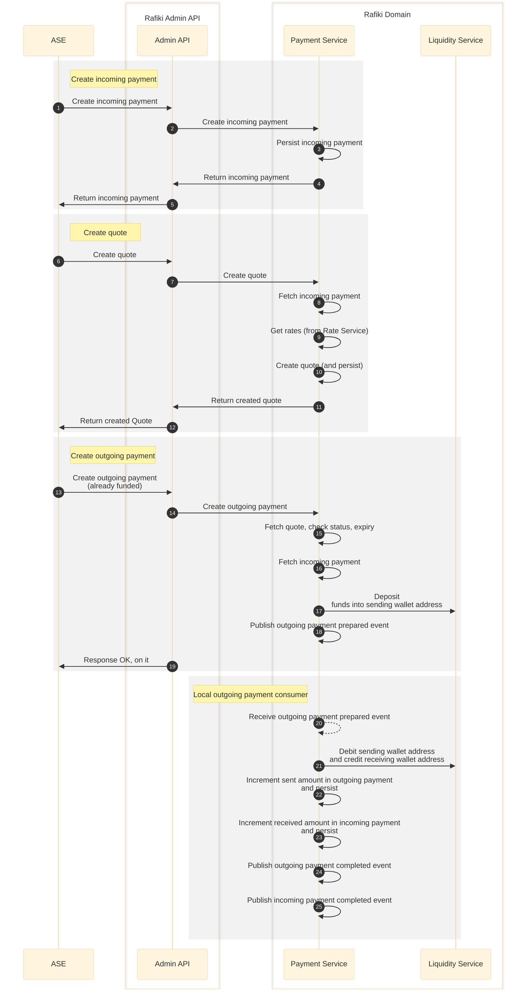
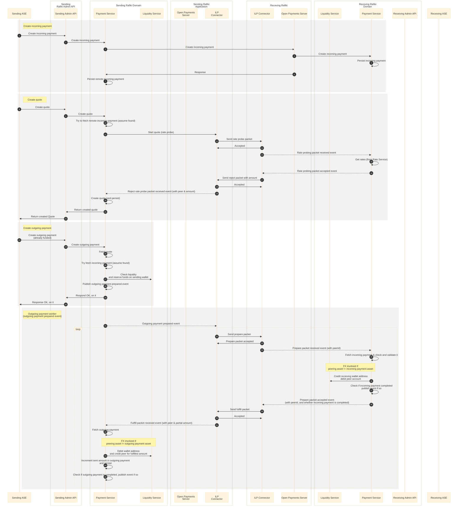

# Rafiki POC

This repository contains a Proof of Concept (PoC) project that explores a new payment flow for Rafiki.

It is intended for experimental purposes only.

## Usage

Prepare correct Node.
```shell
nvm install
nvm use
```

Build and start POC.
```shell
corepack enable
# Install & Build:
pnpm i
pnpm build
# Run (port 3000):
pnpm dev
```

Full build and install:
```shell
pnpm i && pnpm -r build
```

Once ready, run test.
```shell
pnpm test
```

## Docker-Compose

#### Build:
Start the containers up with 3 command handlers and 2 api instances.
```shell
docker compose up -d --build --scale=backend=3 --scale=api=2
```
Then you can run the benchmark as follows:
```shell
k6 run benchmark.js
```

Inspect the logs:
```shell
docker-compose logs -f backend
```

Shut down and clear images and volumes:
```shell
docker-compose down --volumes --rmi all 
```

### Docker

`docker compose -f docker/docker-compose.yaml up`

## Main changes from current implementation

- Event driven
  - Decoupling domains/services (e.g. payments domain and ILP connector interact through events)
  - Workers use message queues (e.g. processing outgoing payments, webhook events)
- Accounting decoupling & improvements
  - Getting payment state, such as the amount sent or received for a payment, doesn't require trips to the accounting database. We now use a concept of "micro-payments" to store that information. Within the the ILP context, one packet = one micro-payment.
  - Avoiding creating "accounting" accounts for individual payments. For example, local payments (within the same Rafiki instance) result in transfers between wallet address accounts (instead of single-use payment liquidity accounts).


## Payments flow

The scope of the PoC is a single payment flow:

1. Creating an incoming payment
2. Creating a quote
3. Creating an outgoing payment
4. Completing the outgoing payment (whether that's a local payment, or through ILP)

### Local Payments

#### Sequence diagram




### Remote Payments

#### Sending prepare packets


#### Receiving prepare packets


#### Sequence diagram




