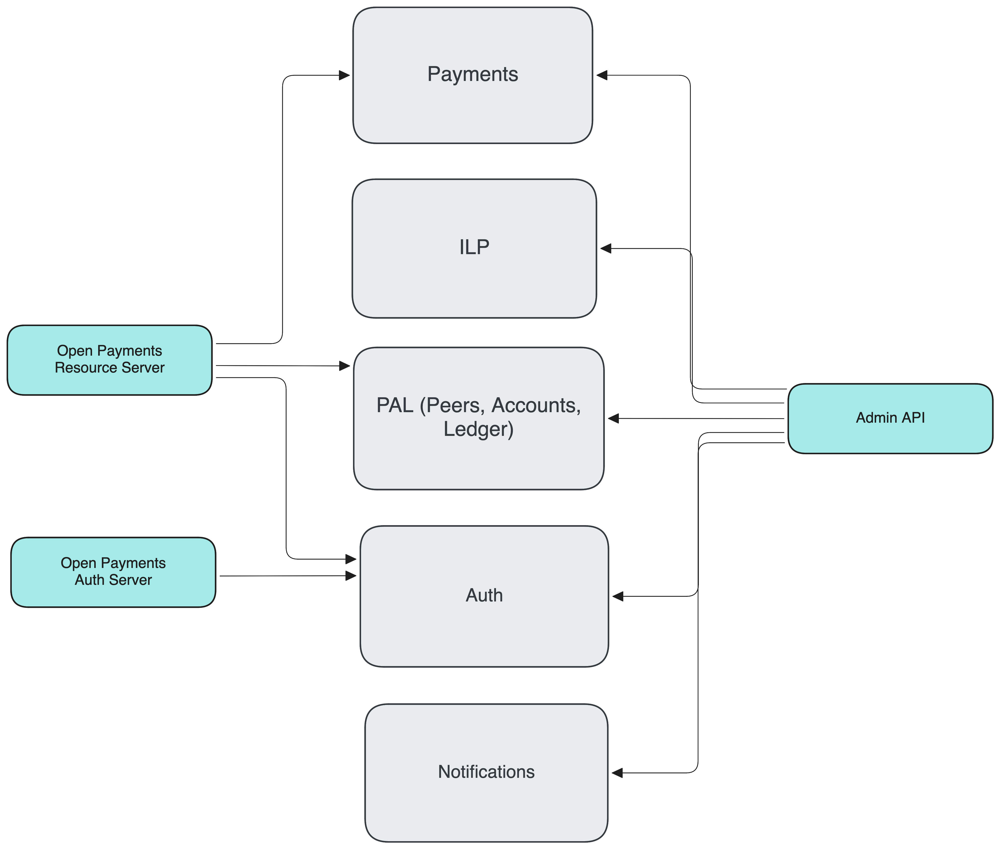

# Architectural differences from Rafiki v1

This document outlines the major architectural changes in Rafiki v2 in comparison to v1. The transition focuses on moving from a monolithic backend to a decoupled, event-driven architecture that prioritizes horizontal scalability, simplified liquidity management, and improved developer experience.

## Core Architectural Shifts

### Bounded Contexts & Services

For better decoupling and horizontal scalability, Rafiki v2 is divided into five distinct system modules (bounded contexts). Instead of `backend` and `auth` services, functionality is split as follows:

- **Payments**: Stores, initiates, and receives payments.
- **ILP**: Handles sending and receiving ILP packets between peers.
- **PAL (Peers, Accounts, Ledger)**: Manages assets, wallet addresses, peers, and all ledger/liquidity functionality.
- **Auth**: Manages Open Payments Auth grants and access tokens.
- **Notifications**: Communicates system events to the ASE via webhook events.

In this architecture, the Open Payments & Admin API servers act as mostly stateless layers that translate external requests into internal commands for the relevant modules.

### Simplified Liquidity

One of the most significant shifts for ASEs is how liquidity is managed:

- **v1**: Liquidity was tracked for every payment, asset, and wallet address.
- **v2**: Liquidity is only tracked for **peering relationships**. There are no longer payment-specific or wallet-address-specific liquidity accounts.

If an ASE only uses Open Payments functionality (and not ILP peering), they no longer need to make liquidity via the Admin API requests or handle liquidity-specific webhook events.

### Simplified Assets

In v2, asset have been simplified: instead of assets being unique by both `code` and `scale`, they are now unique by their `code` only (e.g. USD). The `scale` is now a display property. This is enabled by the fact that the ledger operates at a fixed high precision (scale 20). All accounting entries are stored at this scale, regardless of the display scale of the asset, payment, or peer.

## Infrastructure & Implementation

### MongoDB as Default Database

Our persistence layer has shifted to use MongoDB as a default to support high write throughput, and native horizontal scalability. The code remains structured to allow for alternative persistence implementations (e.g. PostgreSQL) if required.

### Kafka & Event Streaming

The event streaming platform Kafka is the foundation for our event-driven architecture. In addition to powering our custom event-sourced ledger, it enables asynchronous command-based communication across all system modules, supporting horizontal scalability and the ability to replay event streams for recovery or auditing.

### Custom Accounting Ledger

Unlike v1, which often relied on external databases or TigerBeetle for ledgering, v2 uses a **custom event-sourced ledger** built directly on Kafka. This provides a highly performant, auditable accounting system without requiring additional infrastructure dependencies.

## Integration & Lifecycle

### Unified Admin API

Instead of two separate GraphQL Admin APIs for `auth` and `backend`, Rafiki has a single REST Admin API server which covers all of the possible functionality of Rafiki. This simplifies ASE integration (+ documentation tooling) while also providing us the ability to automatically generate client libraries/SDKs.

**Spec**: [Admin API OpenAPI Specification](../packages/admin-api-service/openapi.yaml)

### Webhook Events

While Rafiki v2 continues to use webhooks for ASE notifications, the payload structure and event types have been updated to reflect the new language in the system modules.

**Spec**: [Webhook OpenAPI Specification](../external-docs/webhooks.yaml).

### Multi-tenancy

Rafiki v2 is currently not multi-tenanted. A single Rafiki instance is intended to serve a single ASE, simplifying the security and resource isolation model compared to the multi-tenant approach of v1.
