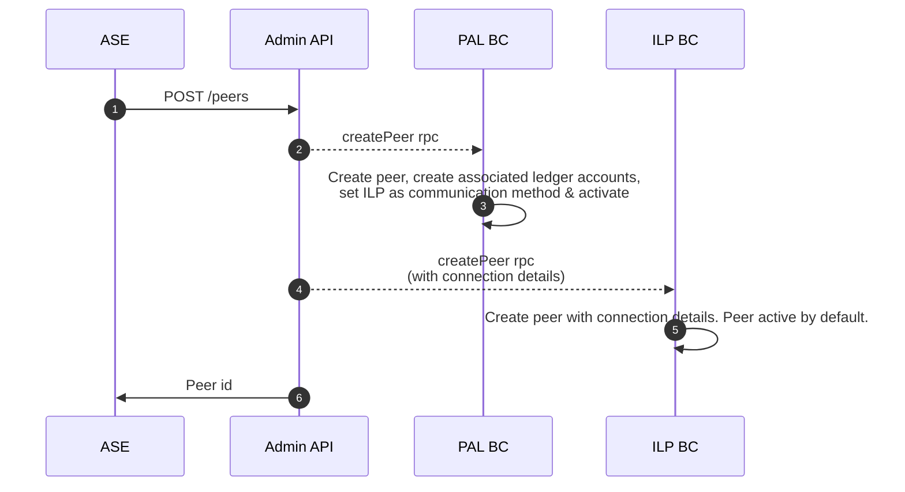
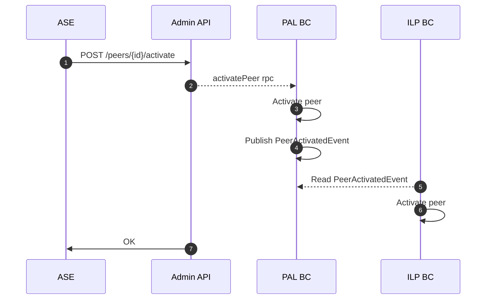
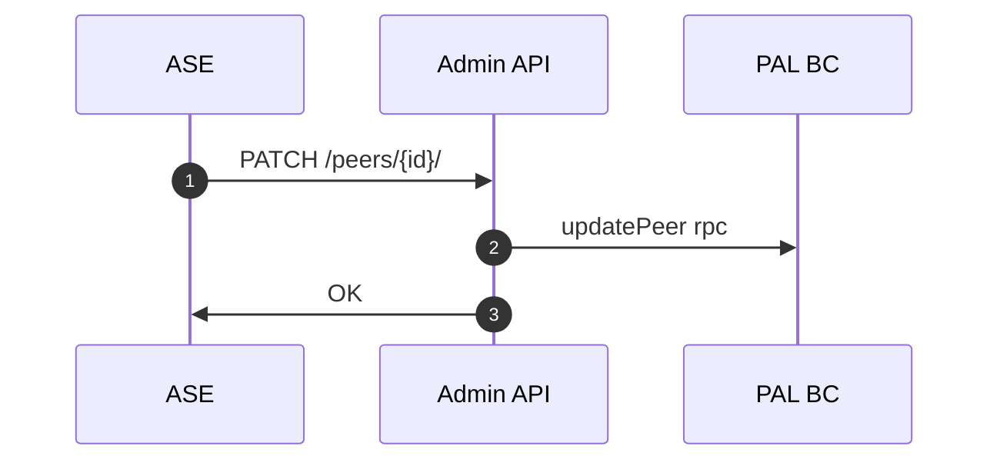
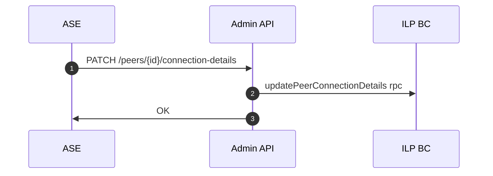
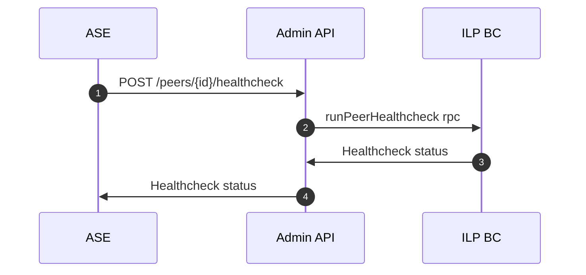

# Peer Lifecycle

- Create peer
- Update ILP connection details
- Ping peer (healthchecks)
- Activate peer
- Deactivate peer

## Peer creation

## Peer activation/deactivation

## Peer basic info update (name or assetScale)

## Peer connection details update

## Peer healthcheck/ping

